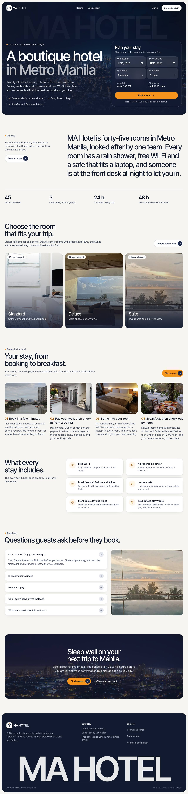

# MA Hotel

MA Hotel is a booking website and back office for a small hotel in Metro Manila with 45 rooms.
Guests find a room, book it and pay online. Hotel staff use the same system to check guests in and out, clean rooms, handle payments and see reports.
The hotel and every guest in it are made up, so you can try everything safely.

<table><tr>
<td width="74%"></td>
<td width="26%"></td>
</tr></table>

## What you can do

**As a guest**
- Look at the rooms and check which ones are free on your dates.
- Book a room. It is kept for you for 10 minutes while you pay.
- Pay by card, GCash or Maya, and get a confirmation by email.
- See, print or cancel your bookings. Cancelling is free up to 48 hours before you arrive.
- Ask the hotel for a copy of your personal details, to correct them or to delete them.

**As hotel staff** (each person only sees the tools for their job)
- **Front desk:** today's arrivals and departures, check-in, check-out and walk-in guests.
- **Housekeeping:** which rooms to clean. A second person checks each room before it goes back on sale.
- **Cashier and manager:** payments, refunds, approvals and reports.
- **IT:** staff accounts, an activity log (a record of who did what) and system health.

## Try it

You need **Docker Desktop** (a free app that runs the whole system in one go).

1. Download this project and open a terminal in its folder.
2. Copy the example settings file: `cp .env.example .env`
3. Start everything: `docker compose up --build`
4. Wait a few minutes, then open <http://localhost:8080>. The first start fills the hotel with sample guests and bookings.

The example settings are for trying it out only. [docs/SETUP.md](docs/SETUP.md) explains what to change for a real hotel.

**Payments are pretend.** Out of the box, the pay button opens a test checkout page that looks like a real one. No money moves. Test card numbers are listed on that page.

## Demo logins

Every demo account uses the password **`ma-hotel-demo`**.

| Sign in as | To try |
| --- | --- |
| `guest@example.test` | Booking a room and your own bookings |
| `reception@example.test` | The front desk |
| `housekeeping@example.test` | Cleaning rooms |
| `cashier@example.test` | Payments |
| `manager@example.test` | Approvals and reports |
| `it@example.test` | Staff accounts and the activity log |

Staff accounts also ask for a 6-digit code, like a bank app does. Add the code key `JBSWY3DPEHPK3PXP` to an authenticator app such as Google Authenticator, or see [docs/SETUP.md](docs/SETUP.md) for a command that prints the code.
Never use these passwords anywhere real.

## More detail

- [docs/SETUP.md](docs/SETUP.md): running it with or without Docker, all settings, payment modes, deploying and backups.
- [docs/ARCHITECTURE.md](docs/ARCHITECTURE.md): how it is built, the business rules, the tests and known limits.
- [docs/SCREENSHOTS.md](docs/SCREENSHOTS.md): every main page on a phone, a tablet and a computer, before and after the redesign.
- [docs/DESIGN.md](docs/DESIGN.md) and [docs/BRAND.md](docs/BRAND.md): the look of the site, the logo, colours and fonts.
- [docs/UI-AUDIT.md](docs/UI-AUDIT.md): the page-by-page design check and what was fixed.

## License

MIT. See [LICENSE](LICENSE).
