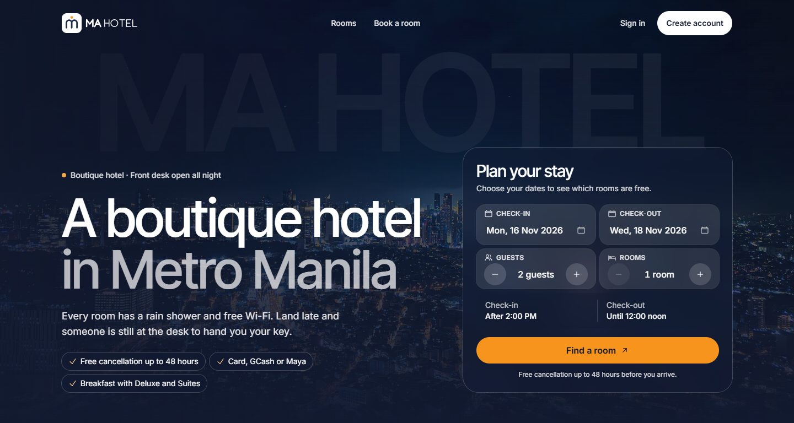

# MA Hotel

A booking website and back office for a small hotel in Metro Manila. Guests find a room, book it and pay online. Staff run the front desk, housekeeping, payments and reports from the same system.
The hotel and every guest in it are made up, so you can try everything safely.



## Run it

You need Windows, [Git](https://git-scm.com), PHP 8.3+ with the `pdo_sqlsrv` extension, and SQL Server 2025 (Express is fine) with TCP on port 1433 and SQL Server and Windows Authentication mode on. The one-time setup is in [docs/SETUP.md](docs/SETUP.md).

```powershell
git clone https://github.com/4regab/hotel-reservation-pms
cd hotel-reservation-pms
powershell -File scripts/dev-stack.ps1 start
start http://127.0.0.1:8100
```

The first start creates the databases and fills the hotel with sample guests and bookings. Starting again keeps your data.
To stop: `powershell -File scripts/dev-stack.ps1 stop`

## Features

**Booking**
- Live room search by dates, guests and rooms, with prices that include VAT.
- Three room types: Standard, Deluxe (breakfast for two) and Suite (breakfast for four).
- A room is held for 10 minutes while the guest pays. Stock is checked for every night, so a room is never sold twice.
- Pay by card, GCash or Maya. A built-in test checkout stands in for PayMongo, and real PayMongo test mode is supported.
- A confirmation email as soon as payment goes through.
- Guest accounts with all bookings in one place. Print a booking or cancel it for free up to 48 hours before arrival.
- Privacy tools: guests can ask for a copy of their data, correct it or delete it.

**Front desk**
- Today's arrivals and departures, check-in and check-out, and walk-in bookings.
- Early-arrival and no-show handling, with manager approval where money is involved.
- Partner (OTA) room allotments and CSV import.

**Housekeeping and maintenance**
- A task board of rooms to clean. A second person inspects each room before it goes back on sale.
- Maintenance can block a room for repairs, and the block is checked against bookings.

**Money and reports**
- Payments, refunds, exports and reports for cashiers and managers.
- Late or repeated payment notices are handled safely: a payment is only counted once.
- Nobody approves their own refund or export.

**Staff and safety**
- Each person sees only the tools for their job (front desk, housekeeping, maintenance, cashier, manager, data steward, IT).
- Staff sign in with a password and a 6-digit code.
- An activity log of who did what, a system health page and a list of privacy requests for IT.
- A data steward can find and merge duplicate guest records.

## Test accounts

Every account uses the password **`ma-hotel-demo`**.

**Guests** need only the email and password.

| Email | What to try |
| --- | --- |
| `guest@example.test` | Booking a room and your own bookings |
| `maribel.dizon@example.com` | A sample guest who already has bookings |

**Staff** also need a 6-digit code, like a bank app. The code key is **`JBSWY3DPEHPK3PXP`**, the same for every staff account.

| Email | Role | What to try |
| --- | --- | --- |
| `reception@example.test`, `reception2@example.test` | Front desk | Arrivals, check-in, check-out, walk-ins |
| `housekeeping@example.test`, `housekeeping2@example.test` | Housekeeping | Clean rooms. One person cleans, the other inspects |
| `maintenance@example.test` | Maintenance | Block a room for repairs |
| `cashier@example.test` | Cashier | Payments, refund requests, exports |
| `manager@example.test`, `manager2@example.test` | Manager | Approvals and reports. The second manager approves what the first asked for |
| `steward@example.test` | Data steward | Possible duplicate guests |
| `it@example.test` | IT | Staff accounts, activity log, system health, privacy requests |

**Getting the 6-digit code.** Add the code key `JBSWY3DPEHPK3PXP` to an authenticator app such as Google Authenticator, or print the current code in PowerShell from the project folder (codes change every 30 seconds):

```powershell
php -r 'require "autoload.php"; echo Portal\Totp::code("JBSWY3DPEHPK3PXP", time()), "\n";'
```

**Payments are pretend.** The pay button opens a test checkout page and no money moves. Test cards are listed on that page, for example `4343 4343 4343 4345` pays successfully. Use any future expiry date and any 3-digit security code.
Never use these passwords or this code key anywhere real.

## Repository layout

```
src/portal  src/booking  src/roomops  src/billing   the four services
src/shared                                            code every service may use
scripts/   tests/unit   tests/e2e   docs/
```

A service may use only the shared code and its own. `php scripts/check-boundaries.php` checks that, and CI runs it. Why the repository is laid out this way: [docs/adr](docs/adr).

## More detail

- [docs/SETUP.md](docs/SETUP.md): one-time setup, all settings, payment modes, troubleshooting, backups.
- [docs/ARCHITECTURE.md](docs/ARCHITECTURE.md): how it is built, the business rules, the tests and known limits.
- [docs/adr](docs/adr): short records of the main design decisions.
- [docs/DESIGN.md](docs/DESIGN.md) and [docs/BRAND.md](docs/BRAND.md): the look of the site, the logo, colours and fonts.

## License

MIT. See [LICENSE](LICENSE).
