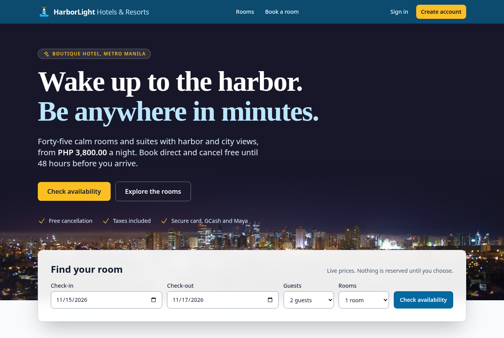
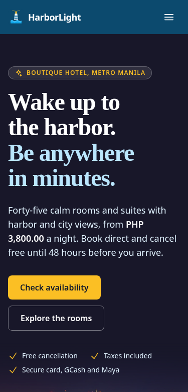
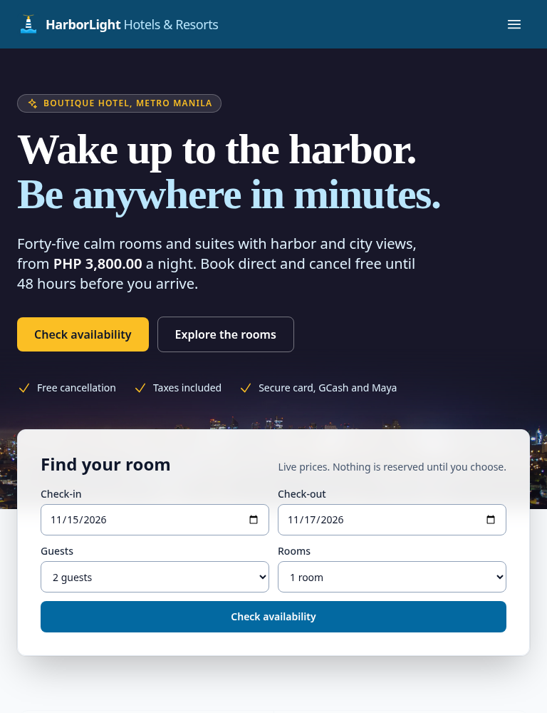

# HarborLight Hotels & Resorts: reservations and property management

A working website and back office for **HarborLight Hotels & Resorts**, a fictional 45-room hotel in Metro Manila
(20 Standard, 15 Deluxe, 10 Suite). Guests search, book and pay online. Staff run the front desk, housekeeping,
payments, partner bookings, reports and privacy requests from the same system.

It is plain PHP 8.3 (no framework, no Composer packages), server-rendered pages with Tailwind CSS and a little vanilla
JavaScript, Microsoft SQL Server 2025, and nginx + PHP-FPM. The compiled CSS is committed, so nothing needs Node to run.



| Phone (375 px) | Tablet (768 px) |
| --- | --- |
|  |  |

More screenshots are in [`docs/screenshots`](docs/screenshots): search results, payment with the hold countdown, confirmation,
front desk, housekeeping board, approvals queue and reports.

## What you can do

**Guests**
- See rooms with photos, bed, size and amenities. Search by dates, guests and rooms. Prices are live and include taxes.
- Pick a room, enter details, and the room is **held for 10 minutes** with a visible countdown. Pay by card, GCash or Maya on the payment provider's hosted page.
- A booking is confirmed only when the provider's signed notice arrives, never because a browser page loaded.
- Confirmation by email (Resend), plus a printable page and a downloadable file. Cancel free until 48 hours before arrival. Receipts, refunds.
- Create an account, reset the password by email, and ask the hotel to give a copy of, correct, or delete their data.

**Staff** (each role sees only its own tools)
- **Reception:** today's arrivals, in-house guests and departures; find any booking by code, name or email; check-in with ID check and room choice; check-out with the bill; walk-in bookings paid at the desk; no-show handling; request pay-at-hotel or early arrival from the manager.
- **Housekeeping:** task board and floor-by-floor room grid. A cleaner marks a room clean, and a **different person inspects** it before it goes back on sale. Report maintenance problems.
- **Maintenance:** block rooms for dates. A block never silently removes a guest's room: conflicts go to the manager.
- **Cashier / finance:** payments, matching payments to the provider statement, refund requests, accounting CSV exports.
- **Manager:** one approvals queue (refunds, pay-at-hotel guarantees, maintenance conflicts, early arrivals, partner allotments, accounting exports), rates and room types, travel partner allotments and CSV import, reports.
- **Data steward:** finds possible duplicate guests (same email, phone or name) and merges them. Sees counts only, never payments or bookings.
- **IT / privacy lead:** users and roles (with second-factor reset), audit log from all four systems, system health (services, event delivery, email), privacy requests.
- **Reports:** occupancy, ADR, RevPAR, revenue, cash by day and method, bookings by channel, and the hotel's seven KPI targets with on/off target marks.

## Architecture

Four small PHP services, each with its **own database and its own database account**, behind one nginx.

```
                      Browser
                         │  HTTPS
                       nginx  ── static files (/assets)
          ┌──────────────┼───────────────┬───────────────┐
          ▼              ▼               ▼               ▼
       Portal        Booking        Room Operations    Billing
   pages, sessions   guests, stock,   rooms, stays,    folios, payments,
   accounts, email   reservations,    cleaning,        refunds, exports
   privacy, audit    OTA partners     maintenance      PayMongo
      (portal_db)    (booking_db)     (roomops_db)     (billing_db)

   Each service: outbox ──scheduled job──> other services' /internal/events (inbox, deduplicated by eventId)
```

| Part | Owns | Notes |
| --- | --- | --- |
| **Portal** (`portal/`) | Accounts, sessions, email jobs and log, privacy requests, audit view | Renders every page and the public `/v1` API. Checks session, role and CSRF, then calls the other services with a signed user context. It cannot sell a room or change a payment itself. |
| **Booking** (`booking/`) | Guests, room types, reservations, dated stock, OTA allotments and imports | One transaction saves a hold, its nights, the counters and its event, or none of them. Rows are locked in date order. |
| **Room Operations** (`roomops/`) | Rooms, stays, assignments, cleaning, maintenance, early-arrival approvals | Locks the room row before assigning. Refuses overlapping assignments. |
| **Billing** (`billing/`) | Bills, charges, payments, refunds, accounting exports | Verifies the payment signature, records a payment once, never stores card data. |
| **Shared library** (`lib/`) | Nothing | Router, PDO, outbox/inbox, idempotency keys, roles, audit, CSV, stock arithmetic. |

How the rules are enforced:

- **Stock.** Counters per room type per night: capacity, blocked, held, confirmed, partner-reserved. A pure function checks every night first and changes nothing if one is short. The database also has `CHECK` constraints, so stock cannot go negative or above capacity even if code is wrong. A test starts 20 simultaneous holds on the last room and proves exactly one wins.
- **Events.** A service writes the event in the same transaction as the change. A scheduled job delivers it over the private network. The receiver records the event id in the same transaction as its own update. Failures retry with growing delays and are flagged for review after 5 tries, never deleted.
- **Late payments.** Paid after the hold expired: try a fresh allocation, otherwise stay unconfirmed and file one refund request. Paid after cancellation: stay cancelled and file one refund request. Replays of the same payment notice do nothing.
- **Separation of duties.** A cashier cannot approve refunds. Nobody approves their own refund or export. The person who cleaned a room cannot inspect it. Housekeeping has no payment or identity access. The steward sees no bookings. IT sees no bookings or payments.
- **Credentials.** Each caller/callee pair has its own secret (`TOKEN_PORTAL_TO_BOOKING` and so on). A container receives only the pairs it sends or receives, plus its own database account. Only the web container publishes a port, and the services' private ports are not reachable from outside.
- **Privacy.** Contact and card data stay out of events, logs and the audit log. Only the identity document *type* is saved. Guests see only their own records (others get 404).
- **Money and time.** Integer centavos, currency PHP, UUID ids, times in UTC, stay dates in Asia/Manila. Check-in 14:00, check-out 12:00.

## Run it

You need Docker with Compose.

```bash
cp .env.example .env     # then change every value that says change-me
docker compose up --build
```

Open <http://localhost:8080>. The first start creates the four databases and their limited accounts, applies the migrations,
creates a first IT account, and (when `SEED_DEMO=1`, the default in `.env.example`) loads about 135 days of invented bookings.
If you left `ADMIN_PASSWORD` empty, the generated first-admin password and authenticator secret are printed once:

```bash
docker compose logs migrate
```

For a real hotel set `SEED_DEMO=0`, `COOKIE_SECURE=1`, a real `PUBLIC_BASE_URL`, and strong secrets (`openssl rand -hex 24`).

### Demo accounts (demo data only)

With `SEED_DEMO=1` every account below uses the password `harborlight-demo` (`DEMO_PASSWORD`). Staff also need a 6-digit code.
The demo authenticator secret is `JBSWY3DPEHPK3PXP` (`DEMO_TOTP_SECRET`). Add it to an authenticator app, or print the current code:

```bash
docker compose exec portal php -r 'require "autoload.php"; echo Portal\Totp::code(getenv("DEMO_TOTP_SECRET") ?: "JBSWY3DPEHPK3PXP", time()), "\n";'
```

| Email | Role | Try this |
| --- | --- | --- |
| `guest@example.test` | guest | My bookings, privacy page |
| `reception@example.test`, `reception2@example.test` | reception | Front desk, check-in, walk-in |
| `housekeeping@example.test`, `housekeeping2@example.test` | housekeeping | Task board (one cleans, the other inspects) |
| `maintenance@example.test` | maintenance | Block a room |
| `cashier@example.test` | cashier | Payments, refund request, export |
| `manager@example.test`, `manager2@example.test` | manager | Approvals queue (the second manager can approve what the first asked for) |
| `steward@example.test` | data steward | Possible duplicate guests |
| `it@example.test` | IT / privacy lead | Users, audit log, health, privacy requests |

Sixteen sample guests also have accounts (for example `maribel.dizon@example.com`) with the same demo password. All names, emails and phone numbers are invented.
Never use these passwords or this authenticator secret anywhere real.

### Without Docker (development)

You need PHP 8.3+ with `pdo_sqlsrv` (Microsoft's driver, plus ODBC Driver 18), and SQL Server 2025 listening on TCP port 1433.
On Windows, run the commands in Git Bash. An empty `DB_ADMIN_USER` signs in with your Windows account, which must be a SQL Server admin.

```bash
export DB_ADMIN_USER=sa DB_ADMIN_PASS=...               # only if you do not sign in with Windows; a login that can create databases
bash scripts/dev-stack.sh start                         # migrate, seed demo data, start the 4 services and the job loop
open http://127.0.0.1:8100
bash scripts/dev-stack.sh stop
```

`scripts/dev-env.sh` holds the demo environment (ports 8100 to 8103, throw-away secrets). This uses PHP's built-in server and is for development and CI only.

### Settings (`.env`)

| Variable | Meaning |
| --- | --- |
| `MSSQL_SA_PASSWORD` | SQL Server `sa` password. Only the one-off `migrate` job and SQL Server itself get it. It needs 8+ characters with three of: upper case, lower case, digits, symbols. |
| `*_DB_PASS`, `*_DB_NAME`, `*_DB_USER` | One limited login per service (select, insert, update, delete; the audit table is append-only). |
| `TOKEN_<FROM>_TO_<TO>` | Twelve service-to-service secrets, one per caller and callee pair. |
| `QUOTE_SECRET` | Signs price quotes (Booking only). |
| `PUBLIC_BASE_URL`, `HTTP_PORT`, `COOKIE_SECURE` | Public address, published port, and whether the session cookie is HTTPS-only. |
| `PAYMONGO_MODE` | `mock` (offline demo checkout page) or `sandbox` (PayMongo test mode). |
| `PAYMONGO_SECRET_KEY`, `PAYMONGO_WEBHOOK_SECRET` | From your PayMongo dashboard. Point the webhook at `<PUBLIC_BASE_URL>/v1/webhooks/paymongo` for the `checkout_session.payment.paid` event. |
| `RESEND_API_KEY`, `MAIL_FROM` | Email through Resend. With no key, emails are written to the log table instead (visible under System health). |
| `ADMIN_EMAIL`, `ADMIN_NAME`, `ADMIN_PASSWORD`, `ADMIN_TOTP_SECRET` | First IT account, created only if none exists. Empty password or secret means generated and printed once. |
| `SEED_DEMO`, `DEMO_PASSWORD`, `DEMO_TOTP_SECRET` | Demo data switch and the demo accounts' shared secrets. |

## Deployment notes

- Put a TLS terminator or load balancer in front of the `web` container and set `COOKIE_SECURE=1` and `PUBLIC_BASE_URL=https://...`. nginx trusts `X-Forwarded-For` from private address ranges so rate limits count real visitors.
- Only publish the `web` container's port 8080. The service ports 8001 to 8004 exist only on the compose network (`/internal/` is also blocked on the public port).
- Containers run as an unprivileged user with a read-only file system and no extra capabilities. The job containers (one small loop per service) can be replaced by cron every minute running the same commands.
- Payments: use `sandbox` first, then live keys. PayMongo shows card forms on its own page, so card numbers never touch this system.
- The compose file uses one SQL Server 2025 Express container, which needs at least 2 GB of memory. For production you can use a managed SQL Server instead and point `*_DB_HOST` at it (add the variables to the service environments). Express is licensed for production; the Developer and Evaluation editions are not.
- Run `docker compose run --rm migrate` after every upgrade. It applies new migrations once and is safe to repeat.

### Backup and restore

```bash
BACKUP_PASSPHRASE=choose-a-long-passphrase scripts/backup.sh          # backups/harborlight-YYYYmmdd-HHMMSS.tar.gz.enc
BACKUP_PASSPHRASE=choose-a-long-passphrase scripts/restore.sh backups/FILE.tar.gz.enc --yes
```

Backups are SQL Server backup files of all four databases (no site downtime, every page checked), packed, compressed and, with a passphrase, encrypted. Copy them **off the machine**. A restore replaces the data in all four
databases, so it needs `--yes`. After a restore, privacy deletions made since the backup are lost: re-apply them from the privacy request list. The scripts also accept
`SQLCMD=` and `SERVER_DIR=` to point at a SQL Server outside Docker (see the script headers). A backup and restore round trip was tested against SQL Server 2025 on Windows.

## Tests

```bash
php tests/run.php                  # 45 logic checks, no database
bash scripts/dev-stack.sh start    # a stack on a real SQL Server
bash tests/e2e/run-all.sh          # the four end-to-end suites below
```

| Suite | What it proves (against the running stack and a real SQL Server) |
| --- | --- |
| `journey` | Register, search, hold, checkout, signed payment notice, confirmation, email recorded, check-in, check-out, cleaning, inspection, room ready again. |
| `features` | Early-arrival approval, no-show money, refund and export separation of duties, partner allotment and CSV import, duplicate merge, maintenance conflict, privacy request (copy and deletion), password reset by email link, who may see what. |
| `concurrency` | 20 parallel holds on the last room: exactly one succeeds, the rest get 409, stock never goes negative or above capacity. Same with 3 rooms left. The database refuses to exceed capacity. |
| `payments` | Forged, altered and missing signatures are refused. A wrong amount is held for review. A payment replayed five times takes effect once. Late payment after expiry confirms with a fresh allocation, or files one refund request when no room is left. Payment after cancellation files one refund request. |

`tests/e2e/browser-flow.mjs` drives the guest booking flow in Chrome at 375, 768 and 1280 px (needs `playwright-core`; it is a developer tool, not part of CI).
GitHub Actions (`.github/workflows/ci.yml`) runs lint, the logic checks, static analysis (PHPStan level 5 with a baseline for older findings), a check that the compiled CSS is current,
the four end-to-end suites on a **SQL Server 2025** service container, and a Docker Compose start-up check.

## Contracts and design system

- [`docs/openapi.yaml`](docs/openapi.yaml): every public `/v1` operation with the roles allowed. **Generated** from the routes and roles by `php scripts/gen-openapi.php`; a logic check fails if it is out of date.
- [`docs/asyncapi.yaml`](docs/asyncapi.yaml): the nine events, who publishes and who consumes them. A logic check compares it with `lib/src/Routing.php`.
- **Design system:** Tailwind CSS v4 with Tailwind's built-in breakpoints only (`sm` 640, `md` 768, `lg` 1024, `xl` 1280). Mobile first. Source `portal/assets/app.src.css`; compiled file `portal/public/assets/app.css` is committed.
  To change styles: `npm install && npm run build:css`. Pages ship no inline script or style (strict Content-Security-Policy). The room and hero pictures are SVG drawings made for this project in `portal/public/assets/img`.
- **Accessibility:** semantic HTML, labelled fields, visible focus, skip link, keyboard-operable menus (native `<details>`), `aria-live` for the hold countdown and messages, charts with titles and text tables, motion off for people who ask for reduced motion, hover effects only on devices that hover.

## Directory map

```
portal/ booking/ roomops/ billing/   public/index.php (routes), src/, bin/ (scheduled jobs), migrations/ (SQL)
portal/views, portal/src/Web         pages and page logic;  portal/assets  Tailwind source
lib/src/                             shared helpers
scripts/                             migrate, seed-demo, dev-stack, backup, restore, gen-openapi, screenshots
docker/, docker-compose.yml          nginx + PHP-FPM + SQL Server
tests/                               logic checks (tests/cases) and end-to-end suites (tests/e2e)
docs/                                OpenAPI, AsyncAPI, screenshots
```

## Limits (what this is not)

- **Tested databases:** the full suite passed on SQL Server 2025 (17.0.1145.4) on Windows. It was **not** run locally against the `mssql/server:2025-latest` Docker image, and `docker compose` was not run locally (not enough memory); the CI workflow does both on GitHub.
- **Payments:** only mock mode was exercised end to end. Sandbox and live PayMongo calls (checkout creation, refunds) are written to the provider's documented shape but were not run against PayMongo.
- **Email:** only the log fallback was exercised. The Resend call is written to Resend's documented API (with an idempotency key per job) but no real message was sent.
- **Webhook age:** signatures are checked but webhook timestamps are not age-limited. Replays are harmless because provider event and payment ids are unique.
- **One host.** Sessions, rate limits and jobs use the database and a loop, which is fine for one hotel and not meant for many servers. Two requests with the same new Idempotency-Key at the same instant are separated by the table's primary key: one gets an error and retries.
- **Reports** are computed from the services when a page opens (a few seconds on years of data). Month-long availability needs an external uptime monitor; the report shows only whether the services are up now.
- **Retention rules** (profiles 24 months after the last stay, abandoned-hold contacts 30 days) are not run automatically. Deletion is done per request by the privacy lead.
- **No marketing email.** Marketing consent is stored separately from booking consent, but nothing sends offers.
- **Access control is by role, not by hotel property.** The system serves one hotel.
- **Accessibility** was built in and checked by eye and by keyboard reasoning, with no automated audit (such as axe) run. Colors were chosen for AA contrast but not measured.
- **Browsers:** checked in Chrome only (desktop width, 768 and 375 px). Scroll-driven reveals need a recent Chrome or Safari and simply show the content in other browsers.
- **Images** are CC0 stock photographs (credits in `docs/IMAGE-CREDITS.md`). The room photos are not of a real property. Replace `portal/public/assets/img/room-*.webp` with your own before launch.

## License

MIT. See [LICENSE](LICENSE).
