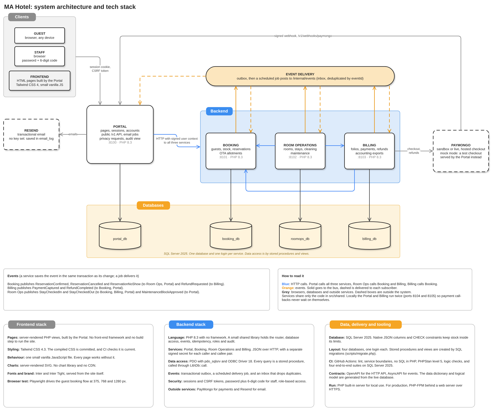

# How MA Hotel is built

Technical detail for developers: the services, how the business rules are enforced, the tests, the contracts and the limits.

## Architecture

Four small PHP services, each with its **own database and its own database account**. Only the Portal faces the browser.

```
                      Browser
                         │  HTTPS
                   web server  ── static files (/assets)
          ┌──────────────┼───────────────┬───────────────┐
          ▼              ▼               ▼               ▼
       Portal        Booking        Room Operations    Billing
   pages, sessions   guests, stock,   rooms, stays,    folios, payments,
   accounts, email   reservations,    cleaning,        refunds, exports
   privacy, audit    OTA partners     maintenance      PayMongo
      (portal_db)    (booking_db)     (roomops_db)     (billing_db)

   Each service: outbox ──scheduled job──> other services' /internal/events (inbox, deduplicated by eventId)
```

| Part | Owns | Notes |
| --- | --- | --- |
| **Portal** (`src/portal/`) | Accounts, sessions, email jobs and log, privacy requests, audit view | Renders every page and the public `/v1` API. Checks session, role and CSRF, then calls the other services with a signed user context. It cannot sell a room or change a payment itself. |
| **Booking** (`src/booking/`) | Guests, room types, reservations, dated stock, OTA allotments and imports | One transaction saves a hold, its nights, the counters and its event, or none of them. Rows are locked in date order. |
| **Room Operations** (`src/roomops/`) | Rooms, stays, assignments, cleaning, maintenance, early-arrival approvals | Locks the room row before assigning. Refuses overlapping assignments. |
| **Billing** (`src/billing/`) | Bills, charges, payments, refunds, accounting exports | Verifies the payment signature, records a payment once, never stores card data. |
| **Shared library** (`src/shared/`) | Nothing | Router, PDO, outbox/inbox, idempotency keys, roles, audit, CSV, stock arithmetic. |

How the rules are enforced:

- **Stock.** Counters per room type per night: capacity, blocked, held, confirmed, partner-reserved. A pure function checks every night first and changes nothing if one is short. The database also has `CHECK` constraints, so stock cannot go negative or above capacity even if code is wrong. A test starts 20 simultaneous holds on the last room and proves exactly one wins.
- **Events.** A service writes the event in the same transaction as the change. A scheduled job delivers it over the private network. The receiver records the event id in the same transaction as its own update. Failures retry with growing delays and are flagged for review after 5 tries, never deleted.
- **Late payments.** Paid after the hold expired: try a fresh allocation, otherwise stay unconfirmed and file one refund request. Paid after cancellation: stay cancelled and file one refund request. Replays of the same payment notice do nothing.
- **Separation of duties.** A cashier cannot approve refunds. Nobody approves their own refund or export. The person who cleaned a room cannot inspect it. Housekeeping has no payment or identity access. The steward sees no bookings. IT sees no bookings or payments.
- **Credentials.** Each caller/callee pair has its own secret (`TOKEN_PORTAL_TO_BOOKING` and so on). A service receives only the pairs it sends or receives, plus its own database account. Only the Portal's port is meant to be public, and the services' private ports must not be reachable from outside.
- **Service boundaries.** A service may use only the shared library (`Lib\`) and its own code. It reaches the others over HTTP and events. `php scripts/check-boundaries.php` fails the build if that is broken, and CI runs it. See [ADR 0003](adr/0003-service-boundaries.md).
- **Privacy.** Contact and card data stay out of events, logs and the audit log. Only the identity document *type* is saved. Guests see only their own records (others get 404).
- **Money and time.** Integer centavos, currency PHP, UUID ids, times in UTC, stay dates in Asia/Manila. Check-in 14:00, check-out 12:00.


## Tests

```powershell
php tests/unit/run.php                         # 45 logic checks, no database
powershell -File scripts/dev-stack.ps1 start   # the site on a real SQL Server
powershell -File tests/e2e/run-all.ps1         # the four end-to-end suites below
```

| Suite | What it proves (against the running stack and a real SQL Server) |
| --- | --- |
| `journey` | Register, search, hold, checkout, signed payment notice, confirmation, email recorded, check-in, check-out, cleaning, inspection, room ready again. |
| `features` | Early-arrival approval, no-show money, refund and export separation of duties, partner allotment and CSV import, duplicate merge, maintenance conflict, privacy request (copy and deletion), password reset by email link, who may see what. |
| `concurrency` | 20 parallel holds on the last room: exactly one succeeds, the rest get 409, stock never goes negative or above capacity. Same with 3 rooms left. The database refuses to exceed capacity. |
| `payments` | Forged, altered and missing signatures are refused. A wrong amount is held for review. A payment replayed five times takes effect once. Late payment after expiry confirms with a fresh allocation, or files one refund request when no room is left. Payment after cancellation files one refund request. |

`tests/e2e/browser-flow.mjs` drives the guest booking flow in Chrome at 375, 768 and 1280 px (needs `playwright-core`; it is a developer tool, not part of CI).
GitHub Actions (`.github/workflows/ci.yml`) runs lint, the logic checks, static analysis (PHPStan level 5 with a baseline for older findings), a check that the compiled CSS is current,
the four end-to-end suites on a **SQL Server 2025** service container.


## Diagram



Editable source: [architecture.drawio](architecture.drawio). Open it in [draw.io](https://app.diagrams.net) (File, Open from, Device).

## Contracts and design system

- [`docs/openapi.yaml`](openapi.yaml): every public `/v1` operation with the roles allowed. **Generated** from the routes and roles by `php scripts/gen-openapi.php`; a logic check fails if it is out of date.
- [`docs/asyncapi.yaml`](asyncapi.yaml): the nine events, who publishes and who consumes them. A logic check compares it with `src/shared/src/Routing.php`.
- **Design system:** Tailwind CSS v4 with Tailwind's built-in breakpoints only (`sm` 640, `md` 768, `lg` 1024, `xl` 1280). Mobile first. Source `src/portal/assets/app.src.css`; compiled file `src/portal/public/assets/app.css` is committed.
  To change styles: `npm install && npm run build:css`. Pages ship no inline script or style (strict Content-Security-Policy).
  Tokens (ink, canvas, clay, dusk), components and the page-by-page plan are in [`docs/DESIGN.md`](DESIGN.md). Logo, colours and fonts are in [`docs/BRAND.md`](BRAND.md).
  Fonts (Inter and Inter Tight, SIL Open Font License) are self-hosted in `src/portal/public/assets/fonts`; no font or script comes from a CDN.
- **Accessibility:** semantic HTML, labelled fields, visible focus, skip link, keyboard-operable menus (native `<details>`), `aria-live` for the hold countdown and messages, charts with titles and text tables, motion off for people who ask for reduced motion, hover effects only on devices that hover.


## Directory map

```
src/portal  src/booking  src/roomops  src/billing   each has public/index.php (routes), src/, bin/ (scheduled jobs), migrations/ (SQL)
src/portal/views, src/portal/src/Web          pages and page logic;  src/portal/assets  Tailwind source
src/shared/src                                      shared helpers (PHP namespace Lib)
scripts/                                            migrate, seed-demo, dev-stack, dev-env, gen-openapi, check-boundaries
tests/                                              logic checks (tests/unit) and end-to-end suites (tests/e2e)
docs/                                               OpenAPI, AsyncAPI, decision records (docs/adr), screenshots
```


## Limits (what this is not)

- **Tested databases:** the full suite passed on SQL Server 2025 (17.0.1145.4) on Windows. The CI workflow runs the same suites on GitHub against the `mssql/server:2025-latest` image.
- **Payments:** only mock mode was exercised end to end. Sandbox and live PayMongo calls (checkout creation, refunds) are written to the provider's documented shape but were not run against PayMongo.
- **Email:** only the log fallback was exercised. The Resend call is written to Resend's documented API (with an idempotency key per job) but no real message was sent.
- **Webhook age:** signatures are checked but webhook timestamps are not age-limited. Replays are harmless because provider event and payment ids are unique.
- **One host.** Sessions, rate limits and jobs use the database and a loop, which is fine for one hotel and not meant for many servers. Two requests with the same new Idempotency-Key at the same instant are separated by the table's primary key: one gets an error and retries.
- **Reports** are computed from the services when a page opens (a few seconds on years of data). Month-long availability needs an external uptime monitor; the report shows only whether the services are up now.
- **Retention rules** (profiles 24 months after the last stay, abandoned-hold contacts 30 days) are not run automatically. Deletion is done per request by the privacy lead.
- **No marketing email.** Marketing consent is stored separately from booking consent, but nothing sends offers.
- **Access control is by role, not by hotel property.** The system serves one hotel.
- **Accessibility** was built in and checked by eye and by keyboard reasoning, with no automated audit (such as axe) run. Text colour pairs were measured against WCAG AA (4.5:1) when the palette was chosen; see `docs/BRAND.md`.
- **Browsers:** checked in Chrome only (desktop width, 768 and 375 px). Scroll-driven reveals need a recent Chrome or Safari and simply show the content in other browsers.
- **Images** are CC0 stock photographs (credits in `docs/IMAGE-CREDITS.md`). The room photos are not of a real property. Replace `src/portal/public/assets/img/room-*.webp` with your own before launch.

